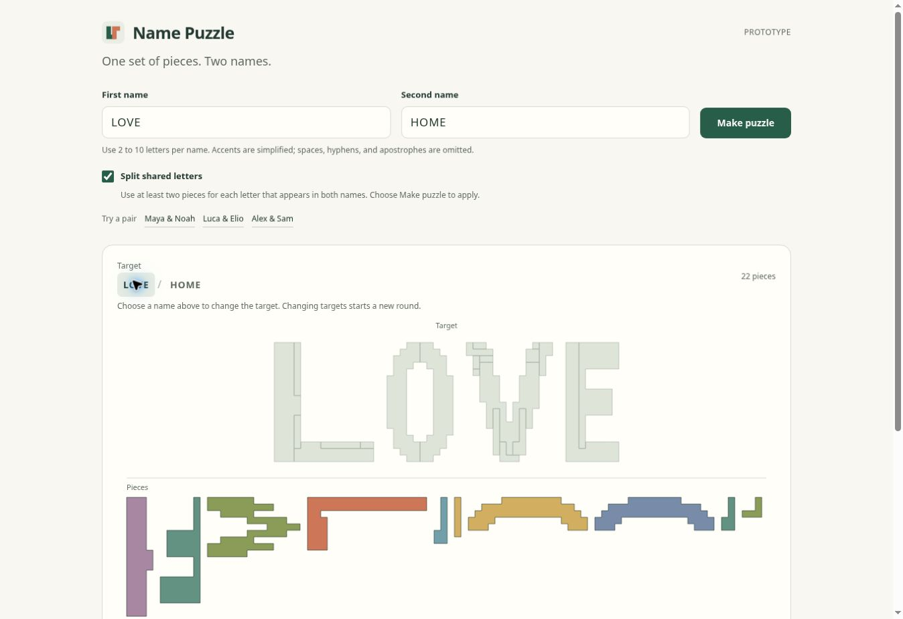

# Name Puzzle

Generate one set of connected pieces that can form either of two names. The application runs in the browser, including the search for matching pieces. GitHub Pages serves the static files.

This is an experimental prototype. Some pairs produce clear lettering and manageable pieces; others produce uneven outlines or many small fragments. Exact geometry does not guarantee a good puzzle.



## Use

Enter two names and choose **Make puzzle**. Select either name or choose **Rearrange** to see the other arrangement. The **Play** button names the outline you will assemble.

Enable **Split shared letters** before choosing **Make puzzle** to require at least two pieces for every occurrence of a letter found in both names. This also applies to repeated letters and identical names. The option does not divide letters that are already split into multiple pieces.

During play, the two name buttons are labeled **Target**. Choose either name to play that target without leaving play mode. Changing the target starts a new round; choosing the active target keeps the current progress.

- Drag pieces with a mouse or touch screen.
- Select a piece and choose **Rotate piece** to turn it.
- With a keyboard, use Tab to select a piece, the arrow keys to move it, and R to rotate it.
- **Place a piece** supplies one hint. **Start over** resets the current round.
- **Copy link** creates a reproducible puzzle link. **New cut** tries the next seed.

Names are normalized to 2 to 10 uppercase letters. Supported accents and ligatures are folded into A to Z. Spaces, hyphens, and apostrophes are removed. The form shows the normalized names after generation.

## Local Development

Use Node.js 22 or later. The project has no package dependencies and needs no install step.

```sh
npm test
npm run dev
```

The development server uses port 4173 by default. Set `PORT` to select a different port. Open the application through the server; opening `index.html` directly does not provide the module and worker environment it needs.

Build the files for publication with:

```sh
npm run build
```

The output is written to `dist/`. The build copies only the application files and creates `version.json` with the package version and deployment commit.

The optional glyph preprocessing script uses the Python standard library. To reproduce the committed version 2 masks, run `python3 scripts/clean-glyphs.py`. Add `--report-dir /tmp/name-puzzle-glyph-review` to write quality measurements and an SVG comparison. It also creates a PNG comparison when Pillow is available. This script is not part of the application build or runtime.

## Deployment

In the repository's **Settings → Pages**, choose **GitHub Actions** as the publishing source. The Pages workflow runs the tests, builds the static site, and deploys changes pushed to `main`. Pull requests run the checks without deployment. There are no scheduled jobs.

The project address is [benton-tripp.github.io/name-puzzle](https://benton-tripp.github.io/name-puzzle/).

## Implementation

- `src/engine.js` normalizes names, creates equal-area targets, searches for common connected pieces, and validates the resulting geometry.
- `src/glyphs.js` retains the original fixed grid glyphs for version 1 links. `src/glyphs-v2.js` contains the cleaned version 2 masks. Using the same masks on each device avoids differences from system fonts and browser text rendering.
- `src/generator.worker.js` runs generation outside the main interface thread.
- `src/board.js` renders the pieces, animates rigid transformations, and handles puzzle interaction.
- `src/share.js` reads and writes versioned puzzle links.
- `src/app.js` connects the form, worker, board, and diagnostics.

The search considers translations and quarter-turn rotations. It scores candidate pieces against the fragmentation they leave behind. It uses an operation limit so difficult inputs cannot search indefinitely. Each result is checked for complete coverage, overlaps, and disconnected pieces before it is returned. The interface also stops a generation job if it exceeds 20 seconds.

Version 2 cleans the letter outlines before the piece search. It constructs E, F, H, I, L, and T from rectangular strokes when an acceptable exact-area construction is available. Other letters use conservative boundary adjustments that reduce isolated tips and notches while preserving their connected strokes and counters. Existing clean contours are retained. The lettering still follows a square grid, and the piece search can still produce small fragments.

Generation Details reports the elapsed time on the current device, the number of pieces, single-square pieces, total area, and seed. These values describe that run. They are not performance estimates for other devices.

## Shared Links and Data

The names, generator version, seed, and shared-letter option are encoded in the URL fragment. There is no application backend, account system, external API, analytics script, or database. Names are not sent to a generation service. A shared link exposes its names to anyone who receives it.

Generation must remain deterministic for a given version, seed, and option set. Any future change that alters the generated geometry must use a new generator version or retain the old implementation for existing links.

Version 1 links retain their original shapes and pieces. New puzzles use version 2. When viewing an original link, choose **Make puzzle** to use the updated letter shapes and options. **New cut** keeps the current puzzle's generator version and shared-letter option.

The prototype does not save unfinished piece positions between page loads.

## Limits

The glyphs use a small square grid, so outlines are visibly stepped. Equal-area lettering can also change letter proportions. Very different name lengths and long names can produce many pieces, including single squares. The generator does not promise a minimum piece size or an optimal dissection.

Desktop browser checks and automated geometry checks cannot establish performance or touch usability on every phone. Test the deployed site on the devices that matter before treating this as a finished application.

## Font Attribution and Related Research

The grid glyphs are derived from DejaVu Sans Bold and are named Name Puzzle Grid and Name Puzzle Grid Two. The applicable font license and notices are preserved in both glyph modules.

Related work on geometric dissection includes [Dissection Font](https://erikdemaine.org/fonts/dissect/), [Dissection Puzzles Composed of Multicolor Polyominoes](https://doi.org/10.1111/cgf.14968), and [Voronoi Scissors](https://anranqi.github.io/VoronoiScissors/). This implementation uses a greedy grid search rather than the continuous optimization method described in Voronoi Scissors.
