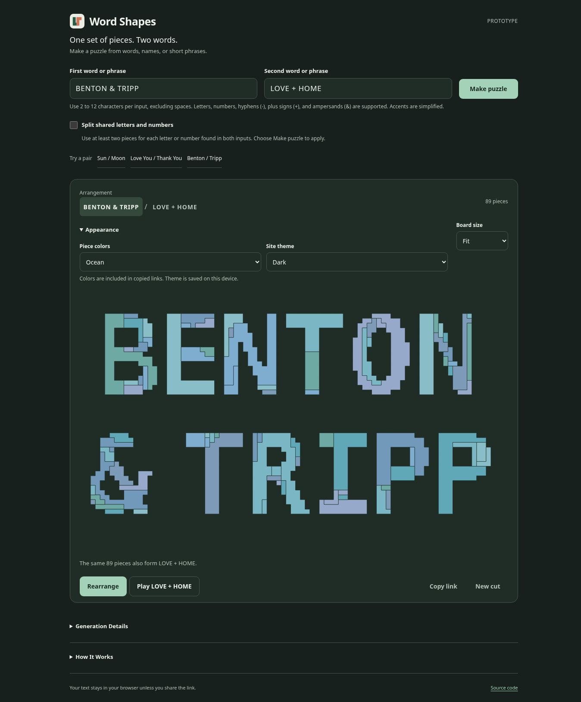

# Word Shapes

Generate one set of connected pieces that can form either of two words, names, or short phrases. The application runs in the browser, including the search for matching pieces. The prototype uses static files for GitHub Pages testing.

This is an experimental prototype. Some pairs produce clear lettering and manageable pieces; others produce uneven outlines or many small fragments. Exact geometry does not guarantee a good puzzle.




## Use

Enter two words or phrases and choose **Make puzzle**. Select either input above the board or choose **Rearrange** to see the other arrangement. The **Play** button identifies the outline you will assemble.

Enable **Split shared letters and numbers** before choosing **Make puzzle** to require at least two pieces for every occurrence of a letter or digit found in both inputs. This includes repeated characters and identical inputs. Punctuation is excluded. Characters already split into multiple pieces need no further division.

During play, the two arrangement buttons are labeled **Target**. Choose either word or phrase to play that target without leaving play mode. Changing the target starts a new round; choosing the active target keeps the current progress.

- Drag pieces with a mouse or touch screen.
- Select a piece and choose **Rotate piece** to turn it.
- With a keyboard, use Tab to select a piece, the arrow keys to move it, and R to rotate it.
- **Place a piece** supplies one hint. **Start over** resets the current round.
- **Copy link** creates a reproducible puzzle link. **New cut** tries the next seed.
- **Board size** offers Fit, 150%, 200%, and 300%. On an enlarged board, scroll or swipe empty space to move around it. Zoom changes the display without changing the pieces.

### Input Rules

Each input must contain 2 to 12 non-space characters, including at least one letter or digit. Supported characters are A to Z, 0 to 9, spaces, hyphens (`-`), plus signs (`+`), and ampersands (`&`).

Letters are converted to uppercase, supported accents and ligatures are folded into A to Z, and common dash variants become hyphens. Leading and trailing whitespace is removed; internal whitespace is collapsed to single spaces. Those spaces remain visible in the arrangement and do not count toward the 12-character limit. Normalized text can contain at most 23 characters including spaces. Unsupported punctuation, including apostrophes, is rejected rather than removed. The form displays the normalized text after generation.

Long phrases can wrap at a space into two centered lines. Words without spaces remain on one line.

### Appearance

Open **Appearance** to choose Classic, Ocean, Sunset, or a solid piece color. The site theme can follow the device setting or use Light or Dark. Appearance preferences are saved in this browser when storage is available. Copied puzzle links include the piece palette and any selected solid color; the site theme remains a local preference.

## Local Development

Use Node.js 22 or later. The project has no package dependencies and needs no install step.

```sh
npm test
npm run dev
```

The development server uses port 4173 by default. Set `PORT` to select a different port. Open the application through the server; opening `index.html` directly does not provide the module and worker environment it needs.

Build the files for publication with:

```sh
npm run build
```

The output is written to `dist/`. The build copies only the application files and creates `version.json` with the package version and deployment commit.

The optional version 2 preprocessing script uses the Python standard library: `python3 scripts/clean-glyphs.py`.

The version 3 letter catalogue is generated by `python3 scripts/build-glyphs.py`. Version 4 retains those letters and adds a separate catalogue generated by `python3 scripts/build-glyphs-v4.py`. The latter imports the version 3 builder's helpers and dependency settings, so both scripts are required to regenerate the additions. The builders verify the source font hashes and require the pinned Pillow and FreeType versions recorded in the scripts. Version 4 also requires the DejaVu Sans Bold font for zero. These offline tools are not part of the application build or runtime.

## Animation Exports

Create local MP4 and GIF animations with birthday, holiday, or New Year styling:

```sh
npm run export:animation -- --preset birthday
npm run export:animation -- --preset holidays
npm run export:animation -- --preset new-year
```

This optional tool requires FFmpeg with SVG support. It writes videos, looping GIFs, still previews, and reproducible settings to `exports/`. The normal website and build do not require FFmpeg. See [Animation Exports](docs/animation-exports.md) for setup, custom words and colors, output sizes, and recipe replay.

## Deployment

GitHub Pages remains the development and testing host. In the repository's **Settings → Pages**, the recommended publishing source is **GitHub Actions**. The Pages workflow runs the tests, builds the static site, and deploys changes pushed to `main`. Pull requests run the checks without deployment. There are no scheduled jobs.

The project address is [benton-tripp.github.io/name-puzzle](https://benton-tripp.github.io/name-puzzle/). Moving to a different domain or host remains a later decision for the owner.

## Implementation

- `src/engine.js` selects the generator version, searches for common connected pieces, and validates the resulting geometry.
- `src/text.js` normalizes and validates version 4 words and phrases.
- `src/lettering.js` retains version 3 lettering. `src/lettering-v4.js` matches the total occupied area of the two version 4 inputs and lays out spaces and line breaks.
- `src/glyphs.js` retains the original fixed grid glyphs for version 1 links. `src/glyphs-v2.js` retains the version 2 masks. `src/glyphs-v3.js` contains the version 3 letter catalogue, also used by version 4. `src/glyphs-v4-extra.js` adds fixed digits and symbols. Using fixed masks on each device avoids differences from system fonts and browser text rendering.
- `src/generator.worker.js` runs generation outside the main interface thread.
- `src/board.js` renders the pieces, animates rigid transformations, and handles puzzle interaction.
- `src/share.js` reads and writes versioned puzzle links.
- `src/appearance.js` manages piece palettes, solid colors, and the site theme.
- `src/app.js` connects the form, worker, board, and diagnostics.

The search considers translations and quarter-turn rotations. It scores candidate pieces against the fragmentation they leave behind. It uses an operation limit so difficult inputs cannot search indefinitely. Each result is checked for complete coverage, overlaps, and disconnected pieces before it is returned. The interface also stops a generation job if it exceeds 20 seconds.

Version 2 cleans the letter outlines before the piece search. It constructs E, F, H, I, L, and T from rectangular strokes when an acceptable exact-area construction is available. Other letters use conservative boundary adjustments that reduce isolated tips and notches while preserving their connected strokes and counters. Existing clean contours are retained. The lettering still follows a square grid, and the piece search can still produce small fragments.

Versions 3 and 4 match the area of each complete input. Individual letters can have different areas, so an I or L does not need to contain as much material as an E or M. A bounded search chooses from fixed glyphs at several sizes, with modest width and raster coverage variations. Each input uses one font size and the original font baseline; repeated occurrences of a character use the same variant. Q retains its descender. The matching process does not add or remove individual edge cells.

Version 4 uses the unchanged version 3 letters and adds fixed digits and the symbols `-`, `+`, and `&`. Zero uses DejaVu Sans Bold to avoid a detached center dot; the other additions use DejaVu Sans Mono Bold. Spaces add gaps without occupied cells. When a phrase is wider than 4.5 capital-letter heights, the layout considers its spaces and chooses a balanced break into at most two centered lines. Each line must contain a letter or digit. The layout is deterministic and does not change with screen size.

The offline catalogue builder rejects disconnected glyphs, damaged counters, and isolated one-cell projections or recesses along otherwise straight boundaries. The catalogue is compressed in the generated module and decoded in the worker with the browser's gzip decompression API. The chosen target pair is reused across all three piece searches. Earlier glyph tables and generation rules remain unchanged.

**Generation Details** reports the elapsed time on the current device, the number of pieces, single-square pieces, total area, and seed. These values describe that run. They are not performance estimates for other devices.

## Shared Links and Data

The two inputs, generator version, seed, shared-character split option, and piece colors are encoded in the URL fragment. There is no application backend, account system, external API, analytics script, or database. Text is not sent to a generation service. A shared link exposes its text to anyone who receives it. Appearance preferences use browser storage; unfinished piece positions are not saved between page loads.

Generation must remain deterministic for a given version, seed, and option set. Any future change that alters the generated geometry must use a new generator version or retain the old implementation for existing links.

Version 1, 2, and 3 links retain their original input rules, shapes, and pieces. New puzzles use version 4. When viewing an earlier link, choose **Make puzzle** to use the current input rules and options. **New cut** keeps the current puzzle's generator version and split option.

## Limits

The glyphs use a square grid, so curves and diagonals remain visibly stepped. The two inputs can use different font sizes to match their total area. Very different lengths and long phrases can produce many pieces, including single squares. Splitting shared characters can add more pieces. The generator does not promise a minimum piece size or an optimal dissection. Zoom makes a board larger on screen; it does not improve the cut itself.

Desktop browser checks and automated geometry checks cannot establish performance or touch usability on every phone. Test the deployed site on the devices that matter before treating this as a finished application.

## Font Attribution and Related Research

Versions 1 and 2 use glyphs derived from DejaVu Sans Bold. Version 3 uses DejaVu Sans Mono Bold. Version 4 retains the version 3 letters, uses DejaVu Sans Mono Bold for its additional characters except zero, and uses DejaVu Sans Bold for zero. Each glyph module retains the applicable font license, notices, and its distinct glyph name.

Related work on geometric dissection includes [Dissection Font](https://erikdemaine.org/fonts/dissect/), [Dissection Puzzles Composed of Multicolor Polyominoes](https://doi.org/10.1111/cgf.14968), and [Voronoi Scissors](https://anranqi.github.io/VoronoiScissors/). This implementation uses a greedy grid search rather than the continuous optimization method described in Voronoi Scissors.
